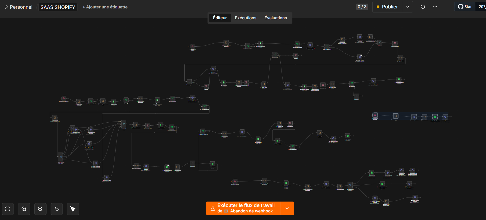
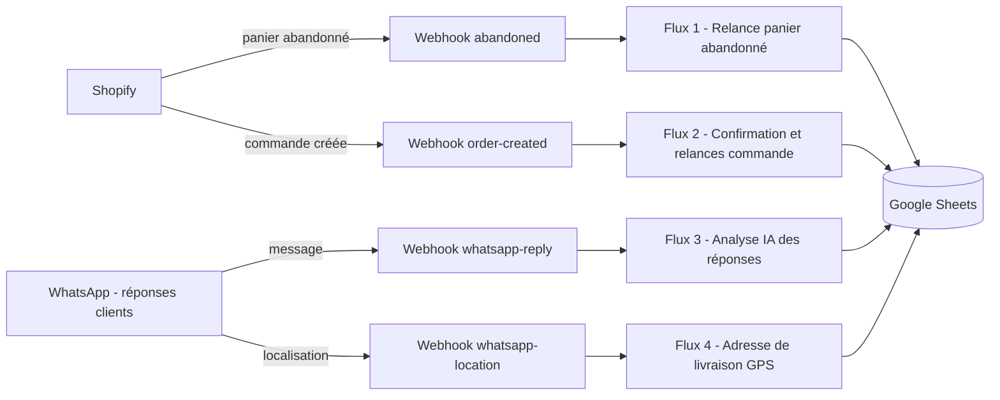

# Shopify Cart Recovery & Order Confirmation - WhatsApp x Gemini x Sheets

Automatisation **n8n** pour boutiques **Shopify** (paiement à la livraison) qui :

- **relance les paniers abandonnés** par WhatsApp (avec SMS en secours) en 3 étapes,
- **confirme les commandes** par WhatsApp et relance les clients qui ne répondent pas,
- **comprend les réponses des clients** (français ou darija) grâce à **Gemini** : confirmation, annulation ou question,
- **récupère l'adresse de livraison** à partir de la localisation GPS WhatsApp,
- trace tout dans **Google Sheets** (commandes, relances, liste noire).

> Projet open source : les contributions sont les bienvenues, voir [CONTRIBUTING.md](CONTRIBUTING.md).

## Aperçu



## Fonctionnalités

- Nettoyage et validation du numéro de téléphone, vérification que le numéro est sur WhatsApp
- **Scoring client** (PLATINUM, VIP, PREMIUM, NORMAL, RISQUE) selon le montant du panier et le nombre d'articles
- Messages de confirmation **personnalisés par niveau** de client, alerte à l'administrateur pour les commandes à risque
- Relances en 3 étapes avec **plage horaire d'envoi** (pas de message la nuit)
- **Liste noire** de numéros et détection de doublons de commande
- Analyse IA des réponses : `CONFIRM`, `CANCEL` ou `QUESTION` (réponse automatique de type SAV)
- Géocodage inverse (OpenStreetMap) de la localisation reçue et notification de l'administrateur
- Historique des relances dans Google Sheets

## Architecture



Le détail de chaque flux est dans [docs/architecture.md](docs/architecture.md).

## Stack

| Brique | Rôle |
|---|---|
| n8n | Orchestration (95 nœuds, 4 webhooks) |
| Shopify | Source des paniers abandonnés et des commandes |
| Green API | Envoi et réception des messages WhatsApp |
| Google Gemini | Analyse des réponses clients et réponses SAV |
| Google Sheets | Base de données légère (commandes, relances, liste noire) |
| Twilio | SMS de secours (à compléter, voir limites) |
| OpenStreetMap Nominatim | Géocodage inverse des adresses |

## Démarrage rapide

1. Créer le Google Sheet à partir de [data/](data/) et le partager avec votre compte de service Google
2. Définir les variables d'environnement (voir [.env.example](.env.example))
3. Importer `workflow.json` dans n8n et connecter la credential Google (compte de service)
4. Remplacer `YOUR_GOOGLE_SHEET_ID_HERE` dans les nœuds Google Sheets
5. Brancher les webhooks Shopify et WhatsApp (voir [docs/payloads-and-testing.md](docs/payloads-and-testing.md))
6. Tester avec les exemples de [examples/](examples/), puis activer le workflow

Guide complet : [docs/installation.md](docs/installation.md)

## Documentation

- [Installation et configuration](docs/installation.md)
- [Architecture des 4 flux](docs/architecture.md)
- [Structure du Google Sheet](docs/google-sheets-schema.md)
- [Payloads attendus et tests](docs/payloads-and-testing.md)
- [Scoring clients et messages](docs/scoring-and-messages.md)
- [Liste des nœuds](docs/nodes.md)
- [Limites connues et roadmap](docs/limitations-and-roadmap.md)

## Contribuer

Les contributions sont ouvertes : corrections de bugs, nouvelles fonctionnalités, traductions, documentation.

1. Regardez les [issues](../../issues), en particulier celles marquées `good first issue` ou `help wanted`
2. Lisez [CONTRIBUTING.md](CONTRIBUTING.md) (surtout la section **export sécurisé d'un workflow n8n**)
3. Ouvrez une issue pour discuter, puis une Pull Request

La liste des problèmes connus, prête à être transformée en issues, est dans [docs/limitations-and-roadmap.md](docs/limitations-and-roadmap.md).

## Structure du repo

```
.
├── workflow.json
├── README.md
├── CONTRIBUTING.md
├── CODE_OF_CONDUCT.md
├── SECURITY.md
├── .env.example
├── .gitignore
├── .github/
│   ├── ISSUE_TEMPLATE/
│   └── PULL_REQUEST_TEMPLATE.md
├── data/            modèles CSV du Google Sheet
├── examples/        payloads de test des 4 webhooks
├── docs/
└── images/
```

## Sécurité

- Aucune clé API, token, numéro de téléphone ni identifiant de feuille dans le repo
- Les secrets sont lus via `$env.*` (n8n) et les accès Google via une credential n8n
- Ne jamais committer un export n8n brut : suivre la checklist de [CONTRIBUTING.md](CONTRIBUTING.md)
- Signalement de vulnérabilité : voir [SECURITY.md](SECURITY.md)

## Avertissement

Green API pilote un compte WhatsApp classique de façon non officielle : un envoi massif peut entraîner le blocage du numéro. Pour un usage commercial à grande échelle, envisagez la WhatsApp Business Platform officielle. Respectez aussi le consentement des clients et la réglementation applicable aux messages commerciaux.

## Auteur

Nombré Alidou Salim

## Licence

MIT
