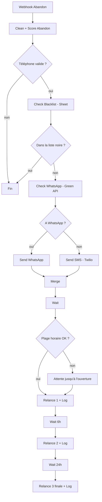
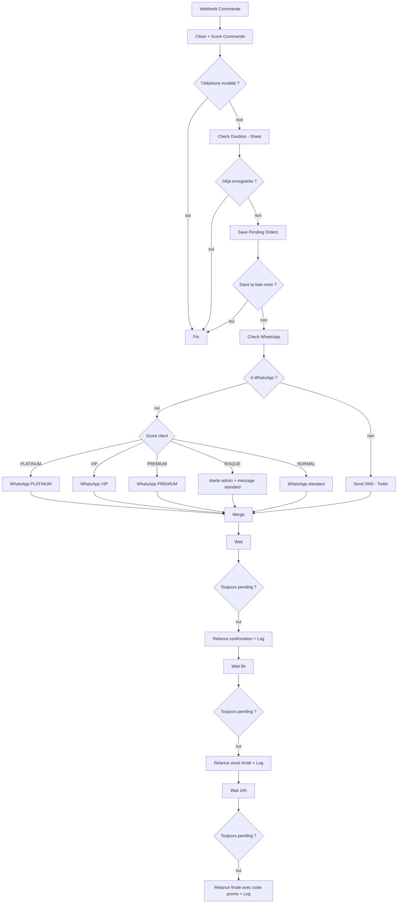
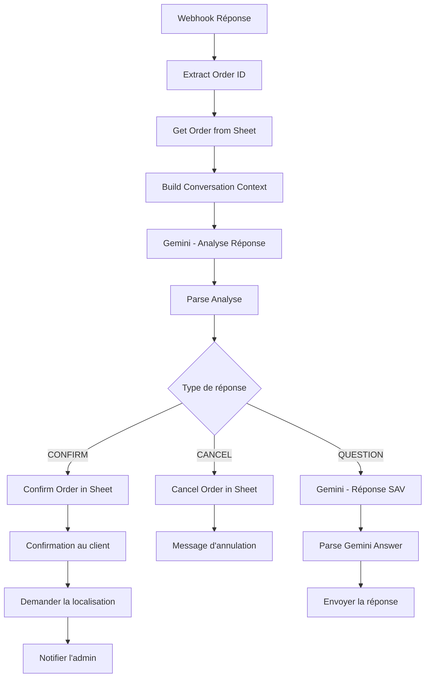
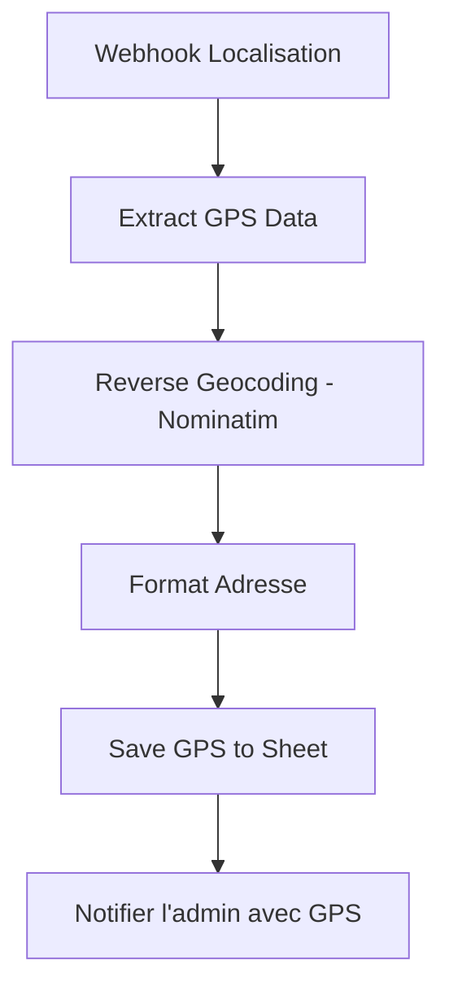

# Architecture des 4 flux

Le workflow contient 95 nœuds répartis en **4 flux indépendants**, chacun déclenché par un webhook.

## Flux 1 - Relance de panier abandonné

Webhook : `POST /webhook/abandoned`

1. Nettoyage du numéro (normalisation `226`), validation, calcul du score
2. Contrôle de la liste noire, puis vérification que le numéro est sur WhatsApp
3. Premier message WhatsApp (ou SMS de secours), puis 3 relances espacées
4. Avant chaque relance : contrôle de la **plage horaire d'envoi**, sinon attente
5. Chaque relance est enregistrée dans `Relances Log`

> ⚠️ Ce flux ne vérifie pas si le client a finalement passé commande entre deux relances (voir [limitations](limitations-and-roadmap.md)).

## Flux 2 - Confirmation de commande et relances

Webhook : `POST /webhook/order-created`

1. Nettoyage, validation, scoring, détection de doublon
2. Enregistrement dans `Pending Orders` avec le statut `pending`
3. Message de confirmation **adapté au niveau du client** (le message demande une réponse OUI/NON avec l'ID de commande)
4. Relances en 3 étapes tant que le statut dans le Sheet reste `pending`

> ⚠️ Le nœud `Node IF Blacklist1` n'est précédé d'aucune recherche dans l'onglet `Blacklist` : dans ce flux, la liste noire n'est donc pas réellement consultée (voir [limitations](limitations-and-roadmap.md)).

## Flux 3 - Analyse IA des réponses clients

Webhook : `POST /webhook/whatsapp-reply`

1. L'ID de commande est extrait du message (motif `ID: xxxx`) ; sans ID, le flux s'arrête
2. Gemini classe la réponse (français ou darija) en `CONFIRM`, `CANCEL` ou `QUESTION`
3. **CONFIRM** : statut `confirmed`, message au client, demande de localisation, alerte admin
4. **CANCEL** : statut `cancelled`, message d'annulation
5. **QUESTION** : Gemini répond comme agent SAV, brièvement, dans la langue du client

## Flux 4 - Adresse de livraison par GPS

Webhook : `POST /webhook/whatsapp-location` (répond avec le dernier nœud)

1. Extraction de la latitude et de la longitude (ou de l'adresse saisie)
2. Géocodage inverse via OpenStreetMap Nominatim
3. Mise à jour de la ligne du client (clé : `phone`) avec adresse, quartier, ville, coordonnées et lien Google Maps
4. Notification WhatsApp à l'administrateur

## Données qui circulent entre les nœuds

Le workflow utilise de nombreux nœuds `Restore ...` (JavaScript) pour ré-injecter les données du client après les appels HTTP et Google Sheets, qui remplacent le contenu de `$json`. Cette technique est lourde : une refactorisation avec le nœud `Set` ou des références `$('Nom du nœud')` est une piste d'amélioration (voir [limitations](limitations-and-roadmap.md)).
